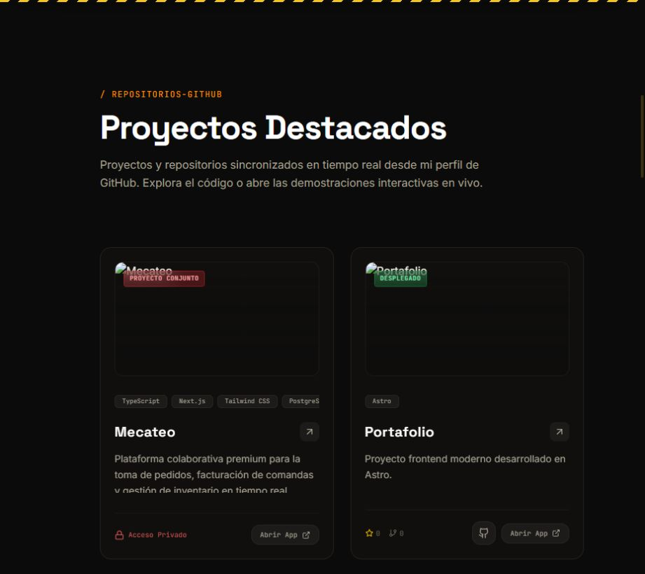

# Portafolio frontend en Astro

Portafolio de Jorge Velásquez con repositorios de GitHub, fichas de proyectos y un grafo interactivo de habilidades.

[Ver el portafolio](https://portafolio-orpin-xi.vercel.app/) · [Código fuente](https://github.com/jevg2003/portafolio)

## Vista del sitio



Captura de la sección de proyectos publicada. Las fichas incorporan los datos de GitHub al generar el sitio.

## Qué incluye

- Cuadrícula de proyectos con enlaces al repositorio y al sitio cuando GitHub informa una URL de despliegue.
- Fichas de proyecto que muestran su README.
- Grafo interactivo de habilidades e interfaz con Astro, Tailwind CSS, GSAP y Lenis.

Los datos del portafolio describen proyectos personales y colaborativos. Consulta cada repositorio para conocer su alcance y las contribuciones de sus autores.

## Decisiones técnicas

- La organización por funcionalidades en [src/features](src/features) separa proyectos, habilidades, navegación y contacto.
- [github.ts](src/features/projects/services/github.ts) consulta los repositorios públicos y mantiene datos de respaldo si la API falla o alcanza su límite. También incluye una ficha de Mecateo, cuyo código es privado.
- [La ruta de detalle](src/pages/project/[id].astro) genera sus páginas con `getStaticPaths` y convierte el README a HTML con Marked. Los cambios de GitHub se incorporan al generar una nueva versión del sitio.
- [astro.config.mjs](astro.config.mjs) configura la precarga de enlaces al pasar el cursor.

## Aportes de Jorge Velásquez

El [rediseño del portafolio](https://github.com/jevg2003/portafolio/commit/8984bee8b5b1f2261b4cf6ccb0a142e9b2b52490), registrado bajo `jevg2003`, incluye la interfaz, la cuadrícula y las fichas de proyectos, el grafo de habilidades y el servicio de GitHub.

## Desarrollo local

Requisitos: Node.js 22.12 o posterior y pnpm. Los comandos disponibles están en [package.json](package.json).

```bash
git clone https://github.com/jevg2003/portafolio.git
cd portafolio
pnpm install
pnpm dev
```

Abre la URL que indique la terminal. El servicio de proyectos consulta la API pública de GitHub; este flujo no requiere un token personal.

```bash
pnpm build
pnpm preview
```

Para revisar el resultado, abre una ficha de proyecto, comprueba sus enlaces y prueba la navegación en una pantalla estrecha.

## English summary

Jorge Velásquez's Astro portfolio presents GitHub projects, README-based detail pages and an interactive skills graph. The project service includes fallback data when the public GitHub API is unavailable.
